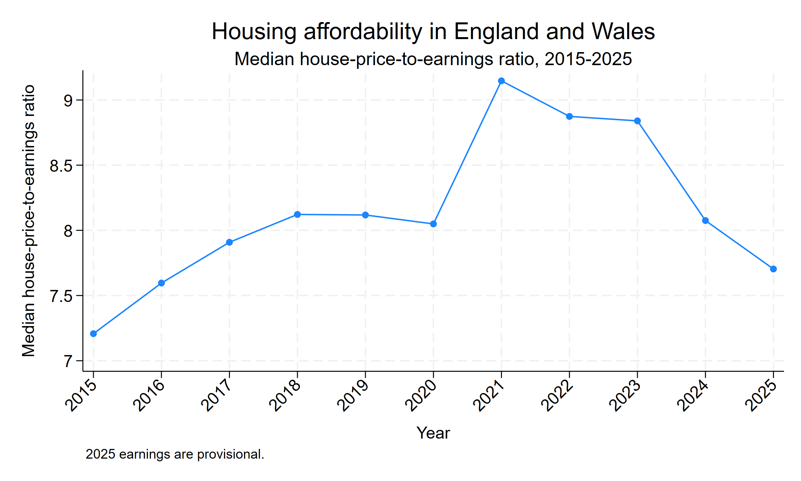
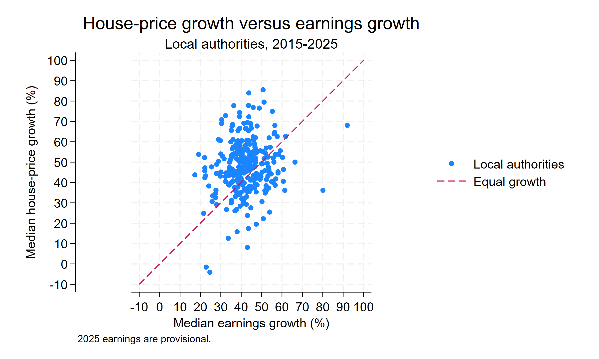
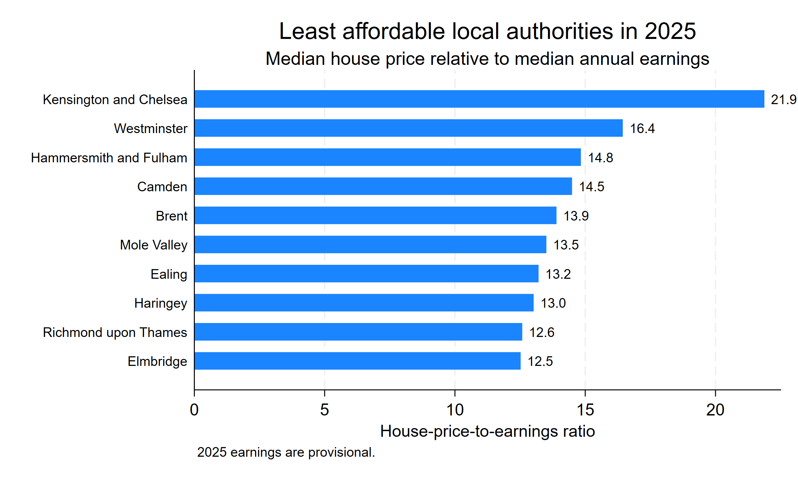
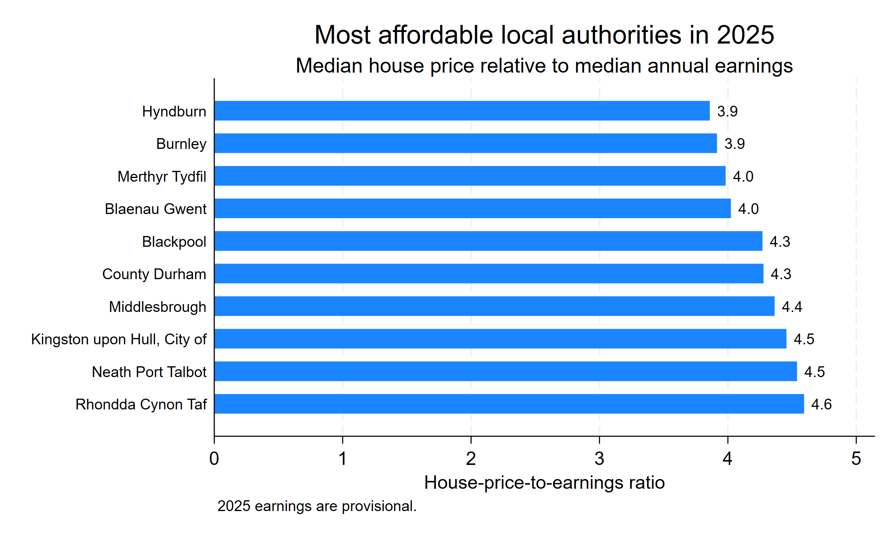

# Housing Affordability in England and Wales, 2015–2025

### A Stata analysis of local house prices and earnings

Housing affordability can look very different depending on where you live. I built this project to examine whether house prices in England and Wales have grown faster than local earnings, how affordability changed over time, and how much the picture differs across local authorities.

The analysis combines ONS earnings data with median house-price data and follows a reproducible Stata workflow from raw files through cleaning, reshaping, merging, quality checks, analysis, robustness testing and visualisation.

## At a glance

- The median house-price-to-earnings ratio rose from **7.2 in 2015** to a peak of **9.1 in 2021**, before falling to **7.7 in 2025**.
- Among the **286 local authorities** with usable earnings at both endpoints, **65.7% were less affordable in 2025 than in 2015**.
- Median house-price growth over 2015–2025 was about **47.6%**, compared with **41.7%** median earnings growth.
- Affordability varied sharply by place in 2025, from ratios below **4** in some authorities to above **20** in Kensington and Chelsea.
- Because 2025 earnings are provisional, I repeated the endpoint analysis through 2024. The overall conclusion remained the same.

## Research question

**Did house prices grow faster than local earnings between 2015 and 2025, and how did housing affordability vary across local authorities?**

## Data

The project combines:

- **ONS Annual Survey of Hours and Earnings (ASHE)** — residence-based median annual full-time earnings, 2015–2025.
- **Median price paid by local authority** — using year-ending September observations.

To keep the comparison consistent over time, I retained **305 local-authority codes** that could be matched across all 11 years.

The `data/` folder keeps the original downloaded source workbooks in their original file formats. I do not manually overwrite the raw files; all cleaning and transformations are handled in the Stata scripts.

Suppressed ONS earnings values were kept as missing rather than imputed.

## Approach

The workflow was completed in Stata.

1. Imported and combined annual earnings files for 2015–2025.
2. Preserved suppressed earnings values before converting the data to numeric form.
3. Filtered the data to relevant local-authority geographies.
4. Reshaped house-price data from wide to long format.
5. Merged house prices and earnings by local-authority code and year.
6. Checked missing values, duplicate identifiers and unmatched geographies.
7. Retained a consistent panel of 305 local-authority codes.
8. Calculated a simple affordability measure:

   **Affordability ratio = Median house price / Median annual earnings**

9. Compared house-price and earnings growth between 2015 and 2025.
10. Repeated the endpoint analysis through 2024 as a robustness check because 2025 earnings are provisional.

## What I found

### Affordability worsened through 2021, then improved



The median house-price-to-earnings ratio increased from **7.2 in 2015** to **9.1 in 2021**. It then declined to **7.7 in 2025**.

This suggests that affordability improved materially after the 2021 peak, but the 2025 ratio was still above its 2015 level.

### In most areas, house prices grew faster than earnings



Each point represents one local authority. The diagonal line marks equal growth in house prices and earnings.

- Points **above** the line indicate that house prices grew faster than earnings.
- Points **below** the line indicate that earnings grew faster than house prices.

Across authorities with usable endpoint earnings, median house-price growth was **47.6%**, compared with **41.7%** median earnings growth.

Overall, **188 of 286 authorities (65.7%)** became less affordable between 2015 and 2025.

### Local differences were substantial in 2025



Kensington and Chelsea had the highest ratio in the 2025 sample at about **21.9**, followed by Westminster at **16.4**. Several of the highest ratios were in London and the South East.



At the other end of the distribution, Hyndburn and Burnley had ratios below **4**, with several authorities in northern England and Wales also among the lowest.

These rankings should be read as affordability **relative to local annual earnings**, rather than as a complete measure of household housing costs.

## Robustness check

The 2025 ASHE earnings data are provisional, so I repeated the endpoint comparison using revised data through 2024.

Using the same **286 local authorities**:

- **65.7%** were less affordable between 2015 and 2025.
- **73.4%** were less affordable between 2015 and 2024.

The direction of the result therefore is not driven by the provisional 2025 earnings data. The difference between the two endpoints also shows that affordability improved noticeably between 2024 and 2025.

## What this project demonstrates

This project shows an end-to-end workflow for turning multiple public datasets into a consistent analytical panel and communicating the results in a way that is easy to follow.

The work covers:

- Multi-file data import and cleaning in Stata
- Data reshaping and one-to-one merges
- Missing and suppressed-value handling
- Geography consistency checks
- Panel-style data preparation
- Descriptive economic analysis
- Robustness checks
- Data visualisation
- Reproducible analysis and documentation

## Notes and limitations

- The house-price-to-earnings ratio is a simple relative-price measure. It does not capture mortgage rates, deposits, taxes, household composition, savings or other living costs.
- Earnings are residence-based median annual full-time earnings.
- Some ASHE estimates are suppressed, so the number of usable authorities varies slightly by year.
- No missing earnings values were imputed.
- The analysis focuses on local-authority codes that could be consistently matched across 2015–2025.
- 2025 earnings are provisional.

## Reproducing the analysis

The do-files use **relative paths**, so there is no user-specific folder path stored in the code.

After downloading or cloning the repository, set Stata's working directory to the repository root and run the files in order:

```stata
cd "path/to/housing-affordability-england-wales"

do "code/01_housing_affordability_analysis.do"
do "code/02_housing_affordability_visualisation.do"
```

The first do-file reads the original Excel workbooks from `data/`, performs the cleaning and analysis, and creates the derived Stata datasets under `output/derived_data/`.

The second do-file uses the final derived dataset to reproduce the figures in `figures/`.

## Repository contents

```text
housing-affordability-england-wales/
│
├── README.md
│
├── code/
│   ├── 01_housing_affordability_analysis.do
│   └── 02_housing_affordability_visualisation.do
│
├── data/
│   ├── earnings/
│   │   └── original ASHE annual earnings workbooks, 2015–2025
│   └── house_prices/
│       └── original median price paid workbook
│
├── figures/
│   ├── affordability_trend.png
│   ├── price_vs_earnings_growth.png
│   ├── least_affordable_2025.png
│   └── most_affordable_2025.png
│
└── output/
    ├── housing_affordability_analysis.log
    ├── housing_affordability_visualisation.log
    └── derived_data/
        └── generated Stata datasets
```

The raw source files remain separate from generated outputs. The Stata do-files provide the full workflow from the original workbooks to the final analysis and figures.

